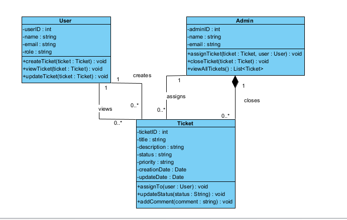

# Laboratoire 2 – Partie 1 : système de gestion de tickets

Cours **6GEI311 Architecture des logiciels**

**Équipe :** Zongo T Julien, Zongo A Razack

Ce projet traduit en Python un diagramme de classes UML d'un système de gestion de tickets. Il contient trois classes, `User`, `Admin` et `Ticket`, et un programme de démonstration qui appelle chaque méthode du diagramme au moins une fois.

La **Partie 2** (conception améliorée avec les patrons State, Template Method, Factory Method et Command) est dans un dépôt séparé : [Laboratoire2_6GEI311_Architecture_des_logiciels_Partie2](https://github.com/zongo-julien/zongo-julien-Laboratoire2_6GEI311_Architecture_des_logiciels_Partie2). Son README présente aussi les diagrammes des deux parties, les captures d'écran et [ce que nous avons appris](https://github.com/zongo-julien/Laboratoire2_6GEI311_Architecture_des_logiciels_Partie2#ce-que-nous-avons-appris).

## Diagramme de classes



## Installation

Il faut Python 3.7 ou plus récent et Git. Aucune dépendance externe n'est nécessaire.

Cloner le dépôt :

```bash
git clone https://github.com/zongo-julien/Laboratoire2_6GEI311_Architecture_des_logiciels_Partie1.git
```

Se placer à la racine du dépôt :

```bash
cd Laboratoire2_6GEI311_Architecture_des_logiciels_Partie1
```

## Utilisation

```bash
python main.py
```

Le programme affiche six sections :

1. Création de 2 `User`, 1 `Admin` et 3 `Ticket`
2. Affichage des propriétés de chaque objet
3. Appel des méthodes de `User` : `createTicket()`, `viewTicket()`, `updateTicket()`
4. Appel des méthodes de `Ticket` : `updateStatus()`, `addComment()`, `assignTo()`
5. Appel des méthodes de `Admin` : `assignTicket()`, `closeTicket()`, `viewAllTickets()`
6. État final de tous les tickets

## Structure du projet

| Fichier     | Contenu                                                              |
|-------------|----------------------------------------------------------------------|
| `user.py`   | Classe `User` : création, consultation et mise à jour de tickets     |
| `admin.py`  | Classe `Admin` : assignation, fermeture et consultation des tickets  |
| `ticket.py` | Classe `Ticket` : assignation, changement de statut, commentaires    |
| `main.py`   | Programme de démonstration                                           |

## Résultats

Chacune des neuf méthodes du diagramme est appelée au moins une fois, et chaque appel est suivi d'une ligne `Résultat :` qui montre son effet sur les objets.

<details>
<summary>Sortie complète de <code>python main.py</code></summary>

```text
============================================================
1. Création des objets
============================================================
Objets créés : 2 User, 1 Admin, 3 Tickets

============================================================
2. Propriétés des objets créés
============================================================
User   : userID=1, name='Abdoul Zongo', email='Abdoul@uqac.ca', role='Développeuse'
User   : userID=2, name='Isma Ky', email='Isma@uqac.ca', role='Testeur'
Admin  : adminID=100, name='Miky COD', email='carole@uqac.ca'
Ticket : ticketID=1, title='Bug de connexion', description='Impossible de se connecter avec un mot de passe valide', status='Ouvert', priority='Haute', creationDate=2026-10-02, updateDate=2026-10-02
Ticket : ticketID=2, title='Erreur d'affichage', description='Le tableau de bord ne s'affiche pas sur mobile', status='Ouvert', priority='Moyenne', creationDate=2026-10-02, updateDate=2026-10-02
Ticket : ticketID=3, title='Demande de fonctionnalité', description='Ajouter un export CSV des tickets', status='Nouveau', priority='Basse', creationDate=2026-10-02, updateDate=2026-10-02

============================================================
3. Méthodes de User
============================================================

--- User.createTicket(ticket) ---
[User Abdoul Zongo] a créé le ticket #1 ('Bug de connexion')
[User Abdoul Zongo] a créé le ticket #2 ('Erreur d'affichage')
[User Isma Ky] a créé le ticket #3 ('Demande de fonctionnalité')
Résultat : Abdoul Zongo a créé [1, 2], Isma Ky a créé [3]

--- User.viewTicket(ticket) ---
[User Abdoul Zongo] consulte le ticket #1 :
    titre       : Bug de connexion
    description : Impossible de se connecter avec un mot de passe valide
    statut      : Ouvert
    priorité    : Haute
    créé le     : 2026-10-02
    mis à jour  : 2026-10-02
[User Isma Ky] consulte le ticket #3 :
    titre       : Demande de fonctionnalité
    description : Ajouter un export CSV des tickets
    statut      : Nouveau
    priorité    : Basse
    créé le     : 2026-10-02
    mis à jour  : 2026-10-02
Résultat : Abdoul Zongo a consulté [1], Isma Ky a consulté [3]

--- User.updateTicket(ticket) ---
[User Abdoul Zongo] a mis à jour le ticket #2 (updateDate = 2026-10-02)
Résultat : Ticket : ticketID=2, title='Erreur d'affichage', description='Le tableau de bord ne s'affiche pas sur mobile', status='Ouvert', priority='Moyenne', creationDate=2026-10-02, updateDate=2026-10-02

============================================================
4. Méthodes de Ticket
============================================================

--- Ticket.updateStatus(status) ---
[Ticket #1] statut : 'Ouvert' -> 'En cours'
Résultat : Ticket : ticketID=1, title='Bug de connexion', description='Impossible de se connecter avec un mot de passe valide', status='En cours', priority='Haute', creationDate=2026-10-02, updateDate=2026-10-02

--- Ticket.addComment(comment) ---
[Ticket #1] commentaire ajouté : "Reproduit sur l'environnement de test."
Résultat : Ticket : ticketID=1, title='Bug de connexion', description='Impossible de se connecter avec un mot de passe valide', status='En cours', priority='Haute', creationDate=2026-10-02, updateDate=2026-10-02

--- Ticket.assignTo(user) (appel direct) ---
[Ticket #3] assigné à l'utilisateur Isma Ky (userID=2)
Résultat : Ticket : ticketID=3, title='Demande de fonctionnalité', description='Ajouter un export CSV des tickets', status='Nouveau', priority='Basse', creationDate=2026-10-02, updateDate=2026-10-02

============================================================
5. Méthodes de Admin
============================================================

--- Admin.assignTicket(ticket, user) ---
[Admin Miky COD] assigne le ticket #1 à Abdoul Zongo
[Ticket #1] assigné à l'utilisateur Abdoul Zongo (userID=1)
[Admin Miky COD] assigne le ticket #2 à Isma Ky
[Ticket #2] assigné à l'utilisateur Isma Ky (userID=2)
Résultat : tickets assignés par Miky COD = [1, 2]

--- Admin.closeTicket(ticket) ---
[Admin Miky COD] ferme le ticket #1
[Ticket #1] statut : 'En cours' -> 'Fermé'
Résultat : Ticket : ticketID=1, title='Bug de connexion', description='Impossible de se connecter avec un mot de passe valide', status='Fermé', priority='Haute', creationDate=2026-10-02, updateDate=2026-10-02

--- Admin.viewAllTickets() ---
[Admin Miky COD] consulte tous les tickets (2 ticket(s))
Résultat : liste de 2 ticket(s) retournée
    Ticket : ticketID=1, title='Bug de connexion', description='Impossible de se connecter avec un mot de passe valide', status='Fermé', priority='Haute', creationDate=2026-10-02, updateDate=2026-10-02
    Ticket : ticketID=2, title='Erreur d'affichage', description='Le tableau de bord ne s'affiche pas sur mobile', status='Ouvert', priority='Moyenne', creationDate=2026-10-02, updateDate=2026-10-02

============================================================
6. État final de tous les tickets
============================================================
Ticket : ticketID=1, title='Bug de connexion', description='Impossible de se connecter avec un mot de passe valide', status='Fermé', priority='Haute', creationDate=2026-10-02, updateDate=2026-10-02
Ticket : ticketID=2, title='Erreur d'affichage', description='Le tableau de bord ne s'affiche pas sur mobile', status='Ouvert', priority='Moyenne', creationDate=2026-10-02, updateDate=2026-10-02
Ticket : ticketID=3, title='Demande de fonctionnalité', description='Ajouter un export CSV des tickets', status='Nouveau', priority='Basse', creationDate=2026-10-02, updateDate=2026-10-02
```

</details>

## Choix d'implémentation

Le code suit le diagramme à la lettre : aucun attribut n'est ajouté au compartiment des classes. Quand le diagramme ne précise pas un comportement, le choix retenu est expliqué en commentaire dans le code. Les principaux :

- **Associations.** Les associations `creates`, `views`, `assigns` et `closes` (multiplicité `0..*`) sont représentées par des listes de références : `createdTickets` et `viewedTickets` dans `User`, `assignedTickets` et `closedTickets` dans `Admin`.
- **Délégation.** `Admin.assignTicket()` appelle `Ticket.assignTo()`, et `Admin.closeTicket()` appelle `Ticket.updateStatus("Fermé")`.
- **Date de mise à jour.** Toute modification d'un ticket (assignation, statut, commentaire, mise à jour) remet `updateDate` à la date du jour.
- **Données non mémorisées.** Le diagramme ne prévoit pas d'attribut pour l'utilisateur assigné ni pour les commentaires. `assignTo()` et `addComment()` se contentent donc d'afficher l'opération.
- **Statut libre.** `status` est une simple chaîne de caractères, sans validation des transitions.
- **`viewAllTickets()`.** Le diagramme ne définit aucun dépôt global de tickets. La méthode renvoie donc les tickets liés à l'admin par ses associations `assigns` et `closes`, sans doublon.
- **Imports circulaires.** `from __future__ import annotations` et `TYPE_CHECKING` évitent l'import circulaire entre `user.py` et `ticket.py`.

## Limites de cette conception

Ces limites découlent directement du diagramme initial, et la Partie 2 les corrige :

- Rien n'empêche une transition absurde : on peut passer d'un ticket ouvert à terminé, ou rouvrir un ticket fermé.
- L'utilisateur assigné et les commentaires ne sont conservés nulle part.
- `viewAllTickets()` ne voit que les tickets déjà manipulés par l'admin, faute de dépôt central.
- N'importe quel code peut modifier directement `ticket.status`.
